<!-- markdownlint-configure-file { "MD033": { "allowed_elements": ["details", "summary"] } } -->

# Architecture: the jay-withers estate

A talk-through deck for the whole estate: what runs where, how a change gets
there, and what keeps it safe. Each slide has a diagram, a few points, and
speaker notes. The other docs hold the detail: [delivery.md](delivery.md),
[repo-standard.md](repo-standard.md), [greenfield.md](greenfield.md) and
[autonomy.md](autonomy.md).

**Presenting it.** On GitHub, or in VS Code's Markdown preview with the
recommended `bierner.markdown-mermaid` extension, each `---` rule starts a
new slide. Scroll one slide at a time and open the speaker notes as you go.
It takes about 20 minutes. For a short version, use slides 1, 4 and 5.

**Keeping it current.** The estate map on slide 1 must name every repo in
`CATALOG.md`, and nothing else. `scripts/architecture-check.py` enforces
that at every session sync, in `make docs-check`, and in `verify.sh` for a
factory worktree. Everything else is kept current through the docs step of
/change: this file owns *how the pieces connect*, so a change that adds or
removes a repo, a shared resource, a dependency, a trust path or a delivery
stage updates the slide that draws it.

Slides: [1 Estate map](#1-the-estate-at-a-glance) ·
[2 Landing zone](#2-the-azure-landing-zone) ·
[3 Shared platform](#3-the-shared-container-apps-platform) ·
[4 An app](#4-anatomy-of-an-app) ·
[5 A change](#5-how-a-change-reaches-dev) ·
[6 Identities](#6-identities-and-trust) ·
[7 Shared tooling](#7-shared-tooling-one-change-everywhere) ·
[8 Watching it](#8-how-you-hear-about-things) ·
[9 Backups](#9-backups) ·
[10 Google Cloud](#10-google-cloud-in-progress) ·
[11 Guardrails](#11-what-stays-human)

---

## 1. The estate at a glance

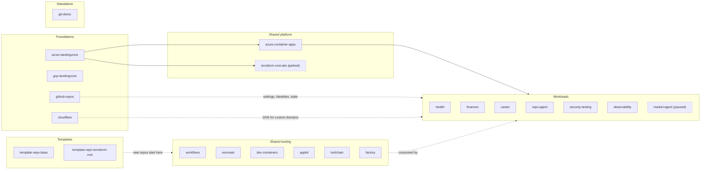

- **Foundations** are applied first and change rarely. **Workloads** are the
  apps, each with its own Terraform, image and CD. **Shared tooling** is
  consumed by nearly every repo, so a change there reaches everywhere.
- Everything is one person's estate, on one Visual Studio subscription with a
  $150/month credit. Most of it scales to zero.
- Dashed boxes are parked: terraform-root-aks (AKS) and market-agent are kept,
  but nothing is being done with them.

Speaker notes

Start here, and come back to this slide whenever someone gets lost. Every
box is a GitHub repo. The arrows mean "has to exist first" (solid) or
"configures or feeds" (dashed).

The canonical list, with its *why*, is the comments in
`repos/github-repos/terraform/terraform.tfvars`. Terraform there creates
every repo and sets the descriptions you see in `CATALOG.md`, so once it's
applied, that file is the truth.

factory, this repo, holds no application code. It's where the work is done:
a clone of every repo, and a worktree per change.

---

## 2. The Azure landing zone

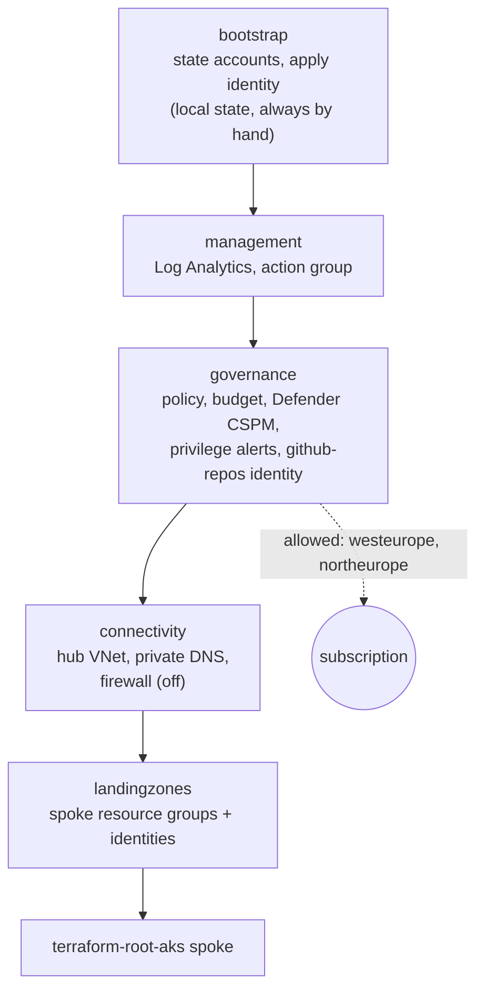

- One repo, `azure-landingzone`, with one Terraform state per component,
  applied in this order. `bootstrap` is always applied by hand. The other four
  plan on merge and apply when you run `cd-terraform`, as one chained job.
- Policy confines everything to two regions. The budget, the anomaly alert and
  the privilege-change alerts all email.
- The landing zone *vends* to spokes: a resource group, an identity and hub
  grants. Only AKS uses that path. Apps take the lighter github-repos path on
  slide 6.

Speaker notes

The order matters. Nothing can `init` before bootstrap creates the state
accounts. governance reads management's workspace. Guardrails go in before
the infrastructure they guard.

bootstrap creates the identity the pipeline applies as, so no pipeline apply
can widen or remove its own rights. That pattern repeats on slide 6.

Rebuilding in a new tenant follows the same order:
[greenfield.md](greenfield.md).

---

## 3. The shared Container Apps platform

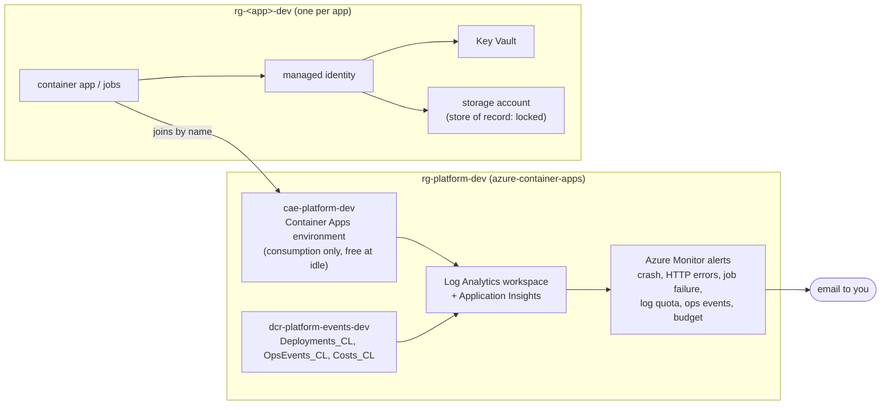

- **One environment for every app.** It holds only what is really shared: the
  environment, the workspace, Application Insights, the alerts and the event
  tables. No Key Vault, identity, registry or database.
- **Each app owns the rest** in its own resource group, and finds the
  environment by name with a data source. No repo reads another's state.
- Nothing here bills while idle: no workload profile and no database server,
  and ingestion stays inside the free grant.

Speaker notes

This split is the main design choice. An app is "a tenant": its blast radius
is its own resource group. Deleting an app never touches the platform, and
the platform can't reach into an app's data.

The trade-off is a shared Log Analytics daily cap. If one app floods it,
ingestion stops for everyone, so the quota is alerted on.

Stores of record (health, finances, career, market-agent storage) carry
`prevent_destroy` and a `CanNotDelete` lock. Pipelines can create locks but
not delete them.

---

## 4. Anatomy of an app

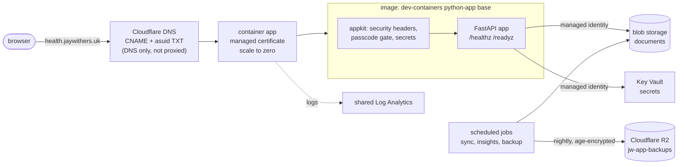

- health is the example. finances and career have the same shape.
  observability (obsview) is a stateless app over the workspace. repo-agent
  and security-testing are jobs only, with no ingress, and are the two that
  aren't Python: repo-agent is a Go binary on distroless, security-testing
  TypeScript on the ZAP image (with `node` copied out of dev-containers'
  `node-app`), so neither uses appkit or python-app.
- **appkit** is the shared library: security headers, the passcode gate,
  secret resolution, `selfcheck` and the backup job. A fix there reaches every
  app on its next bump.
- No Entra sign-in for users, by decision: each public app keeps its own
  passcode gate.

Speaker notes

Walk a request through: DNS at Cloudflare points straight at the
container app (it must stay DNS-only, or the managed certificate can't
validate). The app wakes from zero, appkit's gate checks the passcode, and
FastAPI reads its documents from blob storage as its managed identity. There
are no keys in config.

`/healthz` reports the running version and `/readyz` that dependencies
answer. Every deploy is smoke-tested on those (slide 5). Each job has a
side-effect-free `selfcheck` command for the same reason.

---

## 5. How a change reaches dev

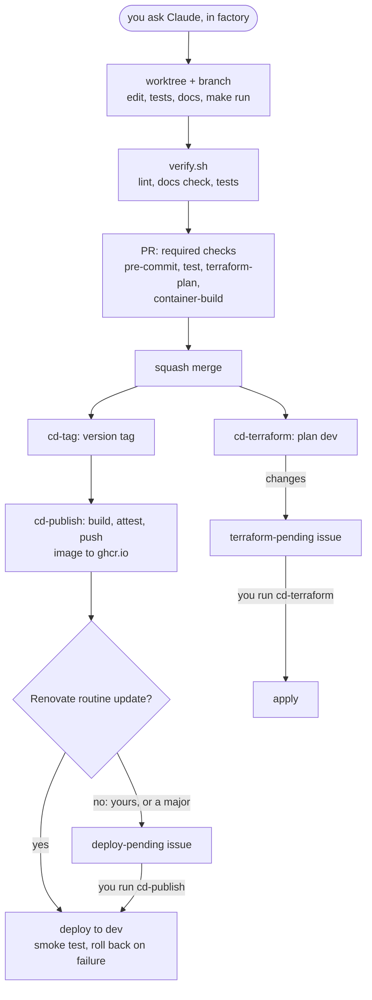

- **Nothing ships unverified.** A Claude Code hook blocks `git push` and
  `gh pr create` unless the commit is exactly what `verify.sh` passed.
- **Merging only deploys Renovate's routine updates.** Your own changes and
  majors wait in a `deploy-pending` issue, and Terraform always waits in a
  `terraform-pending` issue. You run the workflow, from the Actions tab.
- Every deploy is smoke-tested (`/healthz` version, `/readyz`, one `selfcheck`
  run per job, a browser load), and rolled back if it fails.

Speaker notes

This is the slide most people need. Two lanes leave the merge: app code
(image, then deploy) and infrastructure (plan, then a human apply). Only dev
exists. There's no staging, by decision.

Repos are thin callers. The real pipeline is the reusable workflows in
`workflows` (slide 7), so a fix to delivery is made once.

The detail, including every gate and trap, is in
[delivery.md](delivery.md#the-flow).

---

## 6. Identities and trust

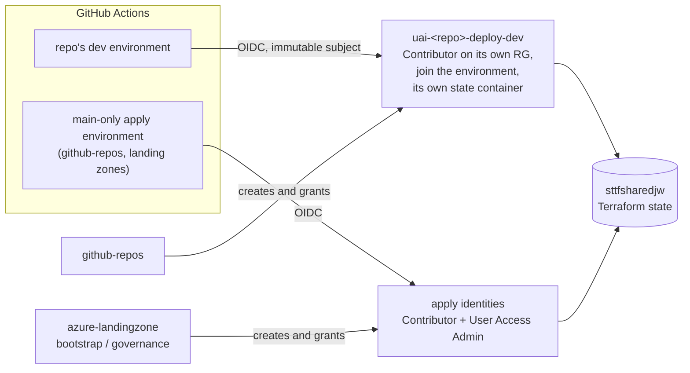

- **No secrets for Azure.** Every pipeline signs in by OIDC, federated to one
  GitHub environment. A job outside it gets nothing.
- **Per-repo deploy identities** come from github-repos. Each one can change
  its own resource group and nothing else, and can't grant Owner, User Access
  Administrator or RBAC Administrator.
- **No identity creates itself.** The apply identities are made by a
  component they can't apply (landing zone `bootstrap` and `governance`), so
  no pipeline can widen its own rights.

Speaker notes

The rule of thumb: the more an identity can do, the fewer places can use it.
Deploy identities work from any `dev` run, but only reach one resource group.
Apply identities reach the subscription, but only from `main`, in an
environment no branch can deploy to. That's also why github-repos and the
landing zones get no credentialled plan on a PR.

Every role assignment, federated credential and lock deletion emails, whoever
did it.

The full grant list and its traps: [delivery.md](delivery.md#identities-and-permissions).

---

## 7. Shared tooling: one change, everywhere

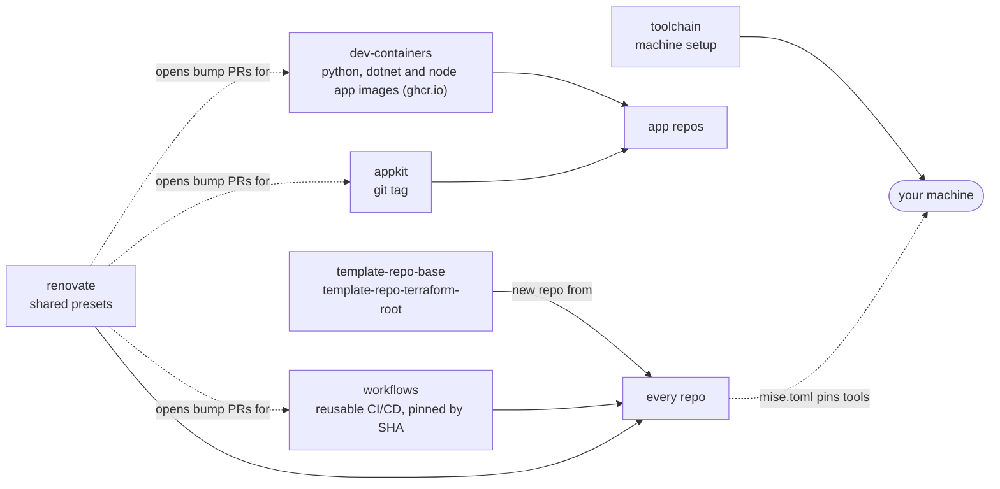

- **A repo's workflows are thin callers** of `workflows`. A fix there reaches
  each repo with its next pin bump, which Renovate opens.
- **Renovate's policy lives in one preset:** a batched Monday schedule, and
  auto-merge for low-risk updates.
- New repos start from a template and follow
  [repo-standard.md](repo-standard.md). That doc also tells a deliberate
  exception from drift.

Speaker notes

The pinning is deliberate: nothing changes under a repo without a PR in that
repo, through its own checks. The cost is a wave of bump PRs after each
shared release. Renovate opens them, and most auto-merge.

Tools come from mise. toolchain sets a machine up once, and each repo's
`mise.toml` pins its versions. CI installs the same ones.

---

## 8. How you hear about things

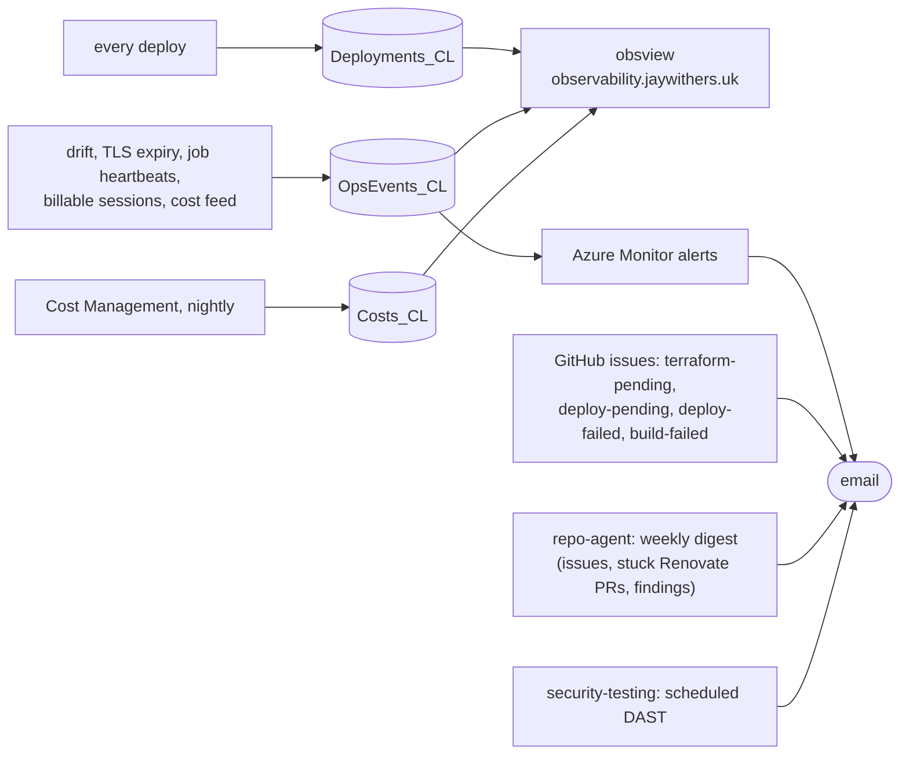

- **Alerts live in Azure Monitor**, so nothing depends on the dashboard being
  awake. obsview is for reading: deploys, health, jobs and spend.
- **Anything waiting for you is a GitHub issue.** Opening it emails you, and
  repo-agent's Sunday digest lists everything still open.
- **A silent emitter is an alert too:** if `OpsEvents_CL` is quiet for two
  days, that fires.

Speaker notes

Three channels, on purpose. Alerts for "something is broken now". Issues for
"something is waiting for you". The digest for "here's what drifted this
week", including any Renovate PR stuck for five days.

Spend has three alarms (a running billable session, a cost anomaly, the
budget), but only the Visual Studio credit's spending limit actually stops
anything.

---

## 9. Backups

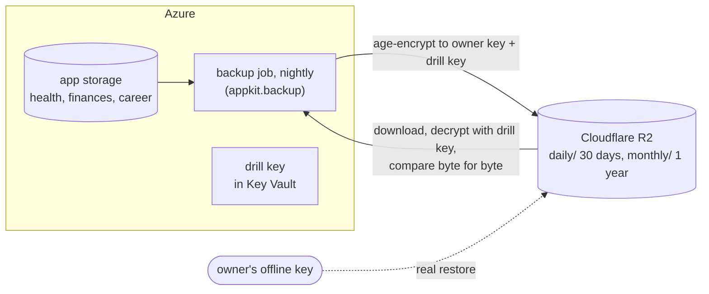

- Off Azure entirely, in R2, which the `cloudflare` repo manages. Retention is
  R2 lifecycle rules, and nothing in the apps deletes.
- **Every run proves its copy restores.** It reads the copy back, decrypts it
  with the drill key and compares it. A failure fails the job, which alerts.
- The owner's private key never goes to Azure, CI or a repo.

Speaker notes

The drill key exists so the backup can be tested on every run without the
real key ever being online. Losing the drill key costs nothing. Losing the
offline key only means restoring with the drill key instead.

---

## 10. Google Cloud (in progress)

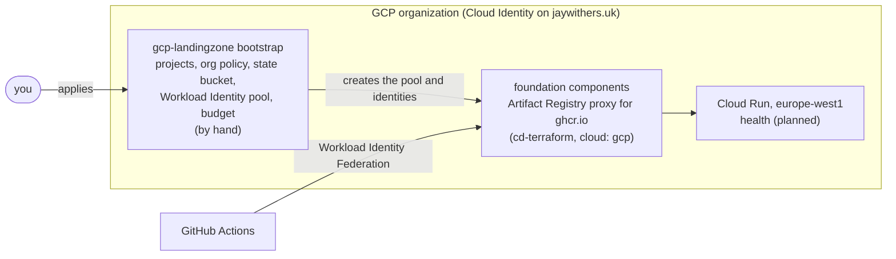

- `gcp-landingzone` is the counterpart of azure-landingzone. Org policy plays
  the part of Azure Policy: one region, no service-account keys, no public
  buckets.
- **health moves here first**, to Cloud Run. Its monitoring becomes GCP-native,
  so it leaves obsview and the Azure alerts. Azure teardown waits for a soak.
- Same trust model as slide 6: bootstrap is applied by a person, and pipelines
  get no rights on the organization.

Speaker notes

This slide will change most. Update it as each step lands: the foundation
components, then health's deploy on Cloud Run, then the Azure teardown.
When health has moved, slides 3, 4 and 8 change too.

---

## 11. What stays human

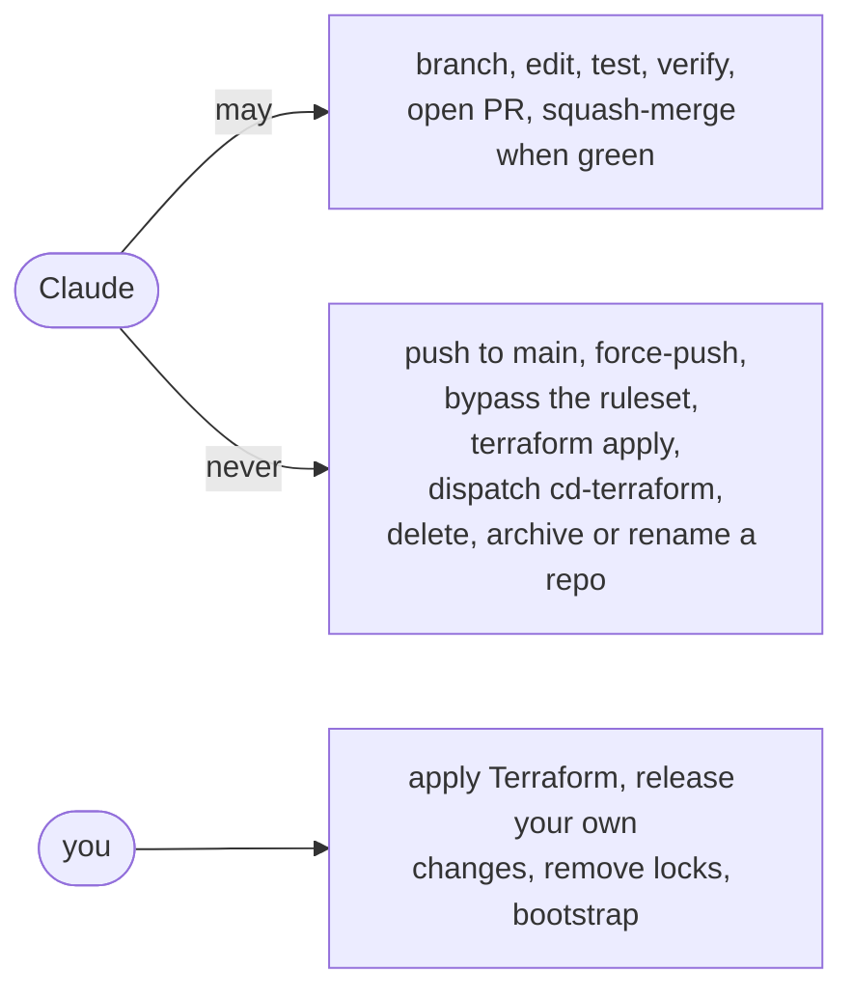

- Every repo's `main` is protected by a ruleset with required checks. There
  is no admin bypass, and merges are squash only.
- Applying infrastructure, releasing your own changes and removing a delete
  lock are always a person's step.
- When Claude asks and when it just proceeds: [autonomy.md](autonomy.md).

Speaker notes

End on this: the speed comes from automation, and the safety from a few
steps that stay with a person. Those steps are small and each is announced
by an issue, so nothing waits silently.

